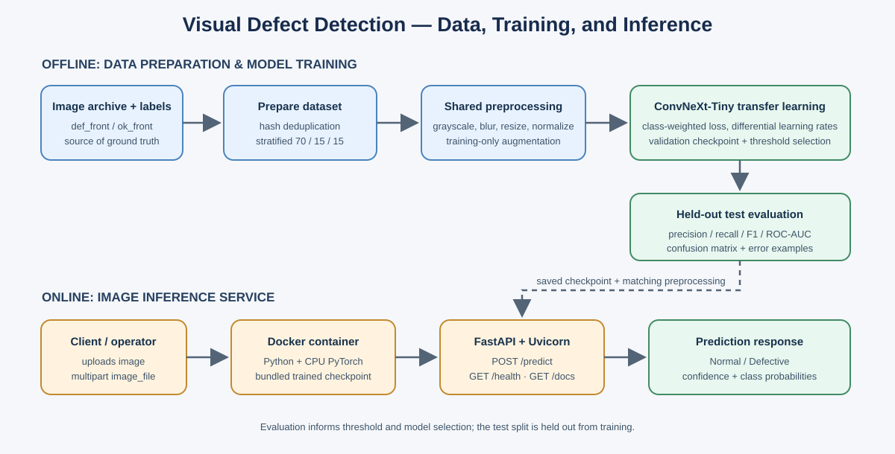

# Product Defect Classifier

Binary visual inspection of casting images as **Normal** or **Defective**.
This repository contains dataset preparation, transfer-learning training,
evaluation/error analysis, and a Dockerized FastAPI inference service.

## Architecture



The offline pipeline prepares and splits labeled images, trains a classifier,
and selects its checkpoint and defect threshold using validation data. The
resulting checkpoint and the same deterministic preprocessing are bundled in
the inference container. Test images are held out from training and threshold
selection.

## Dataset strategy

The dataset can be accessed from this link "https://www.kaggle.com/datasets/ravirajsinh45/real-life-industrial-dataset-of-casting-product"
Place the supplied `archive (1).zip` beside the Python files. It is not
committed because it is a large input dataset. `Dataprep.py` extracts supported
image files from the `casting_512x512` archive path and maps source folders:

| Source folder | Label |
|---|---|
| `def_front` | Defective |
| `ok_front` | Normal |

The preparation pipeline computes SHA-256 hashes, removes exact duplicates,
and stops if identical image contents have conflicting labels. It creates
reproducible, stratified 70%/15%/15% train/validation/test splits (seed 42)
and writes an image-label manifest. The prepared dataset currently contains
1,300 images:

| Split | Normal | Defective | Total |
|---|---:|---:|---:|
| Train | 363 | 547 | 910 |
| Validation | 78 | 117 | 195 |
| Test | 78 | 117 | 195 |

Images are converted to grayscale (replicated over three channels), lightly
Gaussian blurred, resized to 224 x 224, and normalized using the pretrained
image processor's statistics. Horizontal/vertical flips, rotations, and small
translations are applied only to training images. Inverse-frequency
cross-entropy weights address class imbalance.

Exact-hash deduplication does not detect near-duplicate images. If multiple
images can show the same physical part or production batch, use a
part-/batch-grouped split before reporting production performance to avoid
related images leaking across partitions.

## Model and training

The model is pretrained `facebook/convnext-tiny-224` with a replacement
two-class classification head. ConvNeXt-Tiny provides useful pretrained image
features at a more manageable compute cost than a larger backbone. The current
training code fine-tunes the whole model with a backbone learning rate 100
times smaller than the classifier-head learning rate. This may adapt visual
features to casting defects while limiting disruptive updates to pretrained
weights; it requires more CPU/GPU time and memory than freezing the backbone.

`train_model.py` runs stratified five-fold cross-validation on the training
partition and selects checkpoints by validation loss. It then trains a final
model using training data, again selecting its checkpoint by validation loss.
The final operating threshold for predicting Defective is selected on the
validation split to maximize Defective-class F1. That threshold is saved with
the model and reused in test evaluation and API inference. The held-out test
split does not select model weights or the threshold.

An optional, lightweight hyperparameter search compares five configurations
of learning rate, batch size, and weight decay. Each trains for one epoch on
the training split and is scored on the existing validation split; it does not
perform cross-validation or tune epoch count. To enable it, set
`RUN_HYPERPARAMETER_SEARCH = True` in `main.py`. It is disabled by default.

## Evaluation and error analysis

The workspace contains 195 held-out test examples. The metrics below are the
**baseline from the existing checkpoint** at threshold 0.40; they were
recomputed from its saved test labels/predictions and checkpoint scores. The
current training code has since changed to full-backbone fine-tuning and
validation-selected thresholding. Run training again before treating the
baseline as results for that updated training procedure.

| Metric (Defective positive class) | Baseline |
|---|---:|
| Accuracy | 0.8205 |
| Precision | 0.8727 |
| Recall | 0.8205 |
| F1-score | 0.8458 |
| ROC-AUC | 0.9256 |

Confusion matrix (actual rows, predicted columns):

|  | Predicted Normal | Predicted Defective |
|---|---:|---:|
| Actual Normal | 64 | 14 |
| Actual Defective | 21 | 96 |

The baseline has 14 false positives (Normal called Defective) and 21 false
negatives (Defective called Normal). A false negative may allow a faulty item
through; a false positive may send a good item for unnecessary inspection or
rejection. The cost trade-off should be confirmed with the manufacturing
client. A lower defect threshold usually raises recall but increases false
positives; selecting a validation F1 threshold balances the two but does not
guarantee that both error counts fall.

Evaluation artifacts are produced by `evaluate_model.py` in
`submission_artifacts/`: per-image labels and probabilities, summary metrics,
confusion-matrix/ROC plots, selected correct/incorrect example predictions,
and a saved false-positive/false-negative image grid. Regenerate those
artifacts after training before submitting final model results.

### Example predictions from the existing checkpoint

These examples use the current baseline checkpoint at its 0.40 fallback
threshold. Confidence is the softmax probability of the predicted class, not
a calibrated probability.

| Image | Ground truth | Prediction | Confidence |
|---|---|---|---:|
| `cast_ok_0_1028.jpeg` | Normal | Normal | 0.7887 |
| `cast_def_0_1046.jpeg` | Defective | Defective | 0.9773 |

The dataset images are not included in this repository. `casting_imagefolder`
and its trained checkpoints are generated locally and ignored by Git. The
provided archive plus `python main.py` reproduces training; training downloads
the public pretrained ConvNeXt checkpoint from Hugging Face. Docker image
creation requires a locally trained checkpoint at
`casting_imagefolder/final_model`.

## Setup and reproducibility

Use Python 3.11 and install the training dependencies:

```text
pip install -r requirements.txt
```

With `archive (1).zip` in the project root, run:

```text
python main.py
```

This prepares the splits, performs the configured cross-validation/final
training, and evaluates the held-out test set. Model and prepared-data files are
written under `casting_imagefolder/`; evaluation reports are written under
`submission_artifacts/`. The optional K-means label-disagreement
check and hyperparameter search are disabled by default. K-means disagreement
is only a cue for human review, not proof of incorrect labels and not an
automatic relabeler.

Run the tests:

```text
python -m unittest discover -s tests -v
```

## Inference API

After training, start the API locally:

```text
uvicorn api:app --host 127.0.0.1 --port 8000
```

- `GET /health` reports readiness.
- `POST /predict` accepts multipart form data in the `image_file` field.
- `GET /docs` provides interactive Swagger documentation.

Example request:

```text
curl -X POST "http://127.0.0.1:8000/predict" -F "image_file=@sample.jpg"
```

The JSON response contains `predicted_class`, `confidence_score`, and
`class_probabilities`. The API loads its model once at startup and applies the
same deterministic preprocessing and checkpoint threshold as evaluation. It
rejects invalid image content, corrupt images, uploads over 10 MB, and images
over its pixel limit with explicit HTTP errors. Startup, inference failures,
and predictions are logged.

The service currently has no authentication, TLS termination, rate limiting,
or external monitoring. Keep it on localhost for development; before
internet-facing deployment, add a trusted ingress/reverse proxy and operational
monitoring.

## Docker

Build and run the CPU inference container after training:

```text
docker build -t product-defect-classifier:latest .
docker run --rm -p 127.0.0.1:8000:8000 product-defect-classifier:latest
```

If local port 8000 is occupied, map another host port, for example
`127.0.0.1:8001:8000`. The Dockerfile includes CPU PyTorch, API dependencies,
the local checkpoint, and a `/health` container health check. The API listens
on port 8000 inside the container.

## Latency and model trade-offs

On the development machine's CPU, a previous batch-size-1 model-only
measurement was approximately 67-77 ms median and 85-88 ms p95 over 15
forward passes, after warm-up. This is a small local sample and measures only
the model forward pass (not upload, image decoding, preprocessing, container
networking, or cold startup); it is not a production SLA. Re-benchmark the
final checkpoint under expected hardware and concurrent load.

ConvNeXt-Tiny transfer learning is a compromise between accuracy and resource
use. Full fine-tuning can adapt better than a fixed feature extractor but
requires more training time. Threshold tuning trades false negatives against
false positives. The softmax confidence is not calibrated.

## Known limitations and next steps

- The dataset and test partition are small; reported metrics have uncertainty.
- Image-level random splitting may be optimistic if images share a physical
  part, acquisition session, or batch. Use group-based splitting when IDs are
  available.
- The classifier returns a class, not a defect location or explanation.
- Dataset labels may contain errors. Review candidate mislabeled examples
  manually with domain experts; do not automatically relabel from a model or
  K-means disagreement.
- Test results should be regenerated for the final checkpoint, then confirmed
  on a later representative production batch before operational use.
- Measure end-to-end latency, throughput, memory, reliability, and calibration
  on the target deployment platform.
- A GitHub remote and recorded demo video must still be created/submitted by
  the project owner; `VIDEO_DEMO_SCRIPT.txt` provides a suggested 2-3 minute
  outline.
